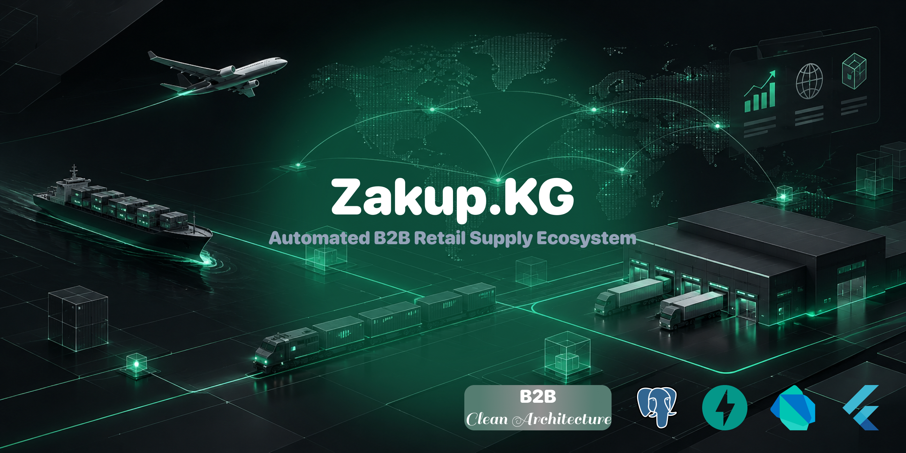

  

## 🎯 Core Concept

A direct digital bridge between retail stores and suppliers, eliminating the need for traditional sales agents. Stores track low inventory, browse catalogs, and place replenishment orders directly, while suppliers process requests and manage deliveries.

## 📍 Current Progress (Stage: UI/UX & MVP)

- [x] Repository initialization
- [x] Brand identity and logo design
- [x] UI/UX mockups (Store flow): Registration, Login, Home Dashboard
- [ ] UI/UX mockups (Store flow): Catalog, Cart, Orders, Profile
- [ ] UI/UX mockups (Supplier flow)
- [ ] MVP Development (Cross-platform Client + Backend API)

## 🗺️ Roadmap

1. **MVP Development:** Building a tested, working prototype with full documentation for client and supplier presentations.
2. **Partnerships:** Onboarding initial wholesale distributors and retail outlets.
3. **Production & Marketing:** Public release, brand promotion, and scaling.

## 🔒 License

**All Rights Reserved.** Unauthorized copying, modification, distribution, or commercial use of this project's materials, designs, or source code without explicit written permission from the copyright holder is strictly prohibited.