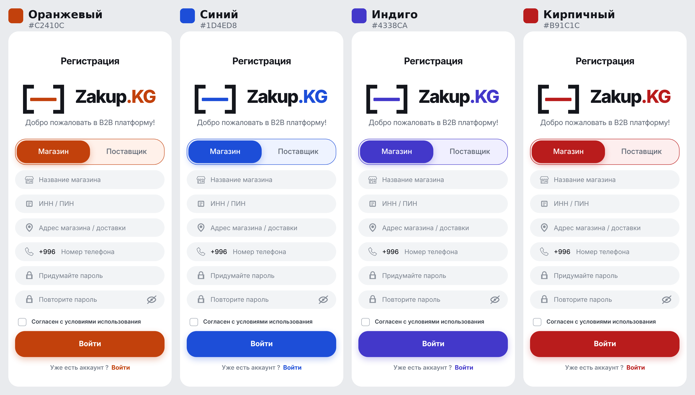

# Наброски по дизайну

Рабочие заметки: что есть, что решили, что осталось выбрать. Обновлять по мере решений.

## Что есть сейчас

| Набросок | Где | Что внутри |
|---|---|---|
| Прототип на 16 экранов | `design/prototype.html` | Магазин и агент: главная, каталог, выбор поставщика, заказ, накладная, профиль и т.д. Светлый, зелёный акцент |
| Набор для Figma | `design/figma/` | Экраны в SVG и PNG, иконки, токены |
| Концепт друга (тёмный) | ветка `Hades`: `Concept Project/WebMaket/`, `Concept IMG — Trush/` | Логотип, регистрация и вход (рабочий HTML), главная магазина (SVG) |
| Концепт друга на белом | `design/concepts/registration-light.html` | Его экран регистрации и входа, фон белый, цвета подогнаны для читаемости |
| Варианты цвета | `design/concepts/color-options.png` | Тот же экран в 4 цветах |

## Что взять из концепта друга

- **Логотип**: квадратные скобки с полоской внутри и надпись Zakup.KG.
- **Регистрация и вход**: переключатель «Магазин / Поставщик», ИНН/ПИН (14 цифр), адрес, телефон с +996, проверка полей.
- **Главная магазина**: блок «Аналитика остатков / Умная закупка» со списком того, что заканчивается, и кнопкой «Собрать заказ».
- **Сканер штрихкодов** в шапке, чтобы быстро найти товар.
- **Фильтры** «Все / Акция / Новинки / Поставщики».
- **Роли**: «Магазин» и «Поставщик» (без отдельного агента) — совпадает с идеей работать напрямую с дистрибьютором.

## Решения

1. **Фон светлый, не тёмный.** Владельцы магазинов часто люди 30+ и старше, смотрят в телефон днём при ярком свете. Тёмную тему можно добавить позже как вариант в настройках.
2. **Не неоновый и не зелёный.** Неон на белом плохо читается и ассоциируется с играми и криптой; зелёный напоминает типичный «нейросетевой» стиль.

## Выбор основного цвета (открыто)

| Цвет | Код | Плюсы | Минусы |
|---|---|---|---|
| Оранжевый | `#C2410C` | Тёплый, «торговый», ассоциируется с едой; почти никто из местных банков и маркетплейсов его не использует | Нужен именно тёмный оттенок, яркий оранжевый с белым текстом плохо читается |
| Синий | `#1D4ED8` | Самый солидный, доверие, хорошо для презентаций дистрибьюторам | Синих приложений много, сложнее выделиться |
| Индиго | `#4338CA` | Современный и спокойный | Близко к Wildberries и Ozon |
| Кирпичный | `#B91C1C` | Яркий, тёплый | Близко к Kaspi |

Рекомендация: **оранжевый**, запасной вариант — **синий**. Решить вместе, потому что цвет меняет и логотип (полоску внутри скобок).

## Ориентиры для аудитории 30+

Приложения, которыми эти люди уже пользуются каждый день:

- **MBank, O!Bank, Optima** — QR-оплата, владельцы магазинов почти наверняка ими пользуются.
- **Kaspi.kz** — эталон простоты для любого возраста.
- **Wildberries, Ozon** — каталог, карточка товара, корзина, статус заказа: ближе всего к нашему продукту.
- **Glovo, Яндекс Go, 2ГИС, WhatsApp** — простые сценарии, крупные кнопки.

Главные примеры для нас: **Kaspi** (простота) и **Wildberries** (каталог и заказы).

## Правила интерфейса

- Светлый фон и один фирменный цвет.
- Основной текст 15–17 px, кнопки не ниже 44 px, крупные зоны нажатия.
- Нижнее меню из 4–5 пунктов: иконка и подпись под ней.
- Одно главное действие на экране, выделенное цветом.
- Фото товаров везде, где возможно: упаковку узнают быстрее названия.
- Простые слова: «Корзина», «Мои заказы», «Оплатить». Без английских терминов.
- Два языка: кыргызский и русский.
- Экраны «резиновые», подстраиваются под любую ширину телефона. Концепт друга сейчас жёстко 402 px и обрезается на большинстве iPhone.

## Мелочи в концепте друга (поправить)

- На экране регистрации кнопка подписана «Войти» — должно быть «Зарегистрироваться».
- В SVG главной не подгрузился шрифт, текст показывается шрифтом с засечками.
- В пустых карточках каталога — заглушки с матом. Убрать перед любыми показами.
- Стили лежат отдельным файлом: на телефоне `index.html` открывается без них. Для показа собирать в один файл.

## Следующие шаги

1. Выбрать основной цвет вместе.
2. Перекрасить прототип на 16 экранов в выбранный цвет и добавить логотип и идеи друга (умная закупка, сканер, фильтры).
3. Добавить экраны регистрации и входа из концепта друга в общий прототип.
4. Обновить набор для Figma и токены.
5. Нарисовать экраны поставщика (дистрибьютора): каталог и цены, входящие заказы, магазины.
